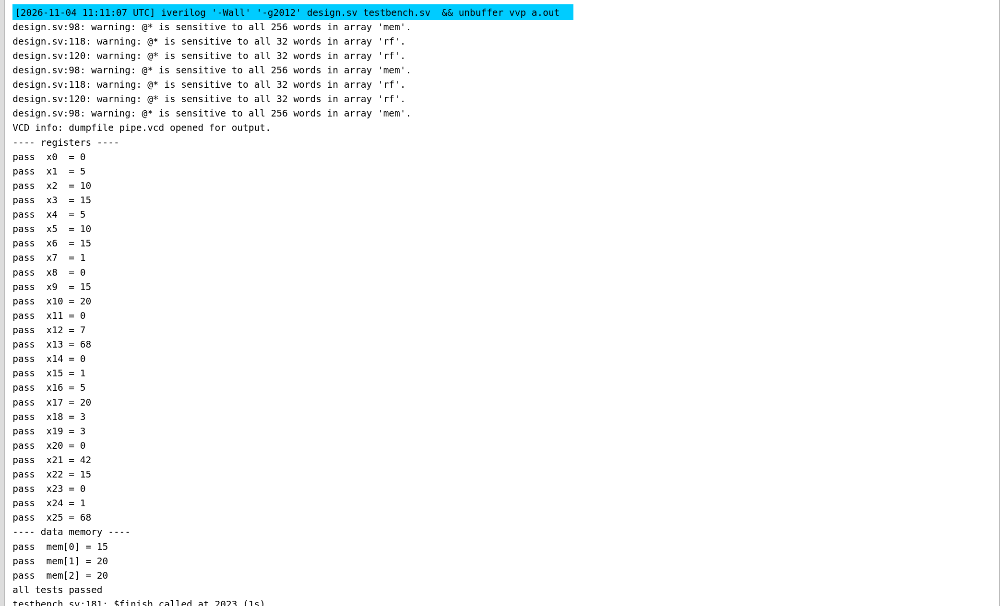
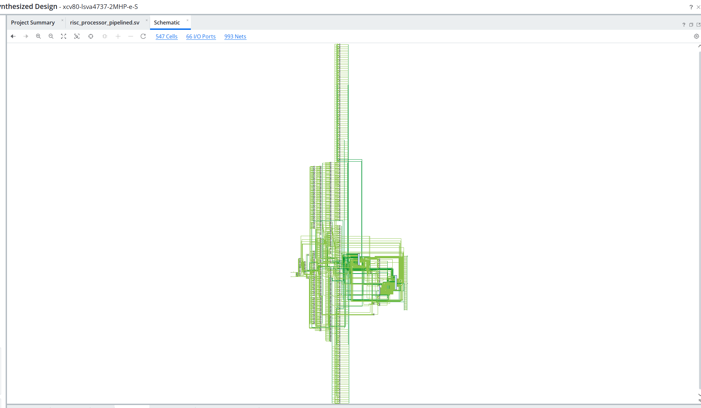
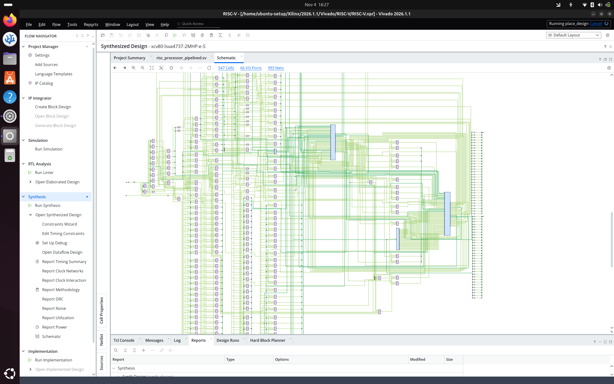
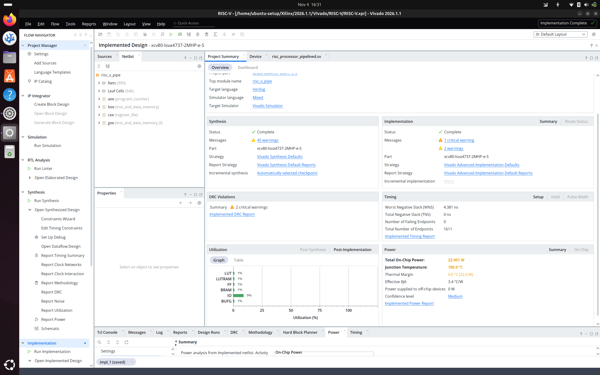
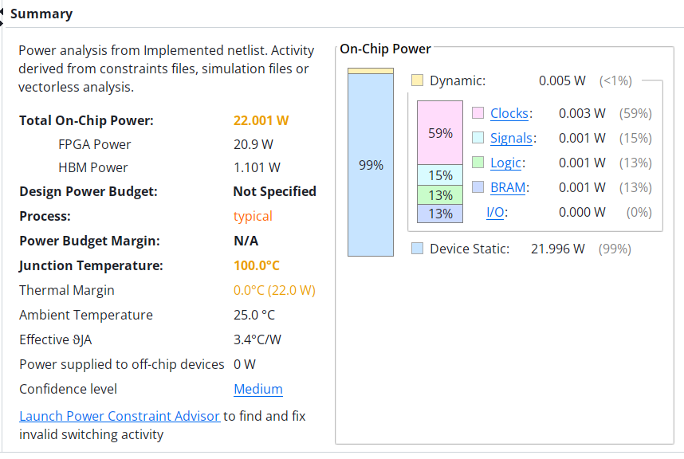

# 5-Stage Pipelined RISC-V Processor

A 32-bit RISC-V processor implemented in Verilog, featuring a five-stage pipeline, data forwarding, hazard detection, and branch handling. The design was simulated using Icarus Verilog and synthesized and implemented using AMD Xilinx Vivado.

## Architecture

The processor follows a five-stage pipeline:

1. **Instruction Fetch (IF):** Fetches instructions and updates the program counter.
2. **Instruction Decode (ID):** Decodes instructions, reads the register file, and generates control signals.
3. **Execute (EX):** Performs ALU operations, evaluates branches, and calculates memory addresses.
4. **Memory Access (MEM):** Handles load and store operations.
5. **Write Back (WB):** Writes execution results back into the register file.

### Pipeline Architecture

The implementation uses pipeline registers between successive stages to propagate instruction data and control signals.

*Architectural reference: Digital Design and Computer Architecture by David Money Harris and Sarah L. Harris.*

## Supported Instructions

The implemented instruction subset includes:

| Type | Instructions |
|------|--------------|
| R-Type | ADD, SUB, AND, OR, SLT |
| I-Type | ADDI, SLTI |
| Load | LW |
| Store | SW |
| Branch | BEQ |
| Jump | JAL |

## Key Features

- Five-stage pipelined datapath.
- 32-bit ALU supporting arithmetic, logical, and comparison operations.
- 32-register register file with x0 hardwired to zero.
- Separate instruction-fetch and data-memory instances.
- Data forwarding from the MEM and WB stages.
- Load-use hazard detection with pipeline stalling.
- Pipeline flushing for taken branches and jumps.
- Immediate generation for I, S, B, and J instruction formats.
- Branch resolution in the execute stage.

## Verification

The processor was verified using a custom Verilog testbench.

The testbench checks register values and data-memory contents after executing a test program containing arithmetic operations, memory accesses, branches, and jumps.

Specific scenarios include:
- Arithmetic and logical instruction execution.
- Data forwarding between pipeline stages.
- Load-use hazard detection and stalling.
- Store-data forwarding.
- Taken and not-taken branches.
- Pipeline flushing after taken branches.
- JAL return-address handling.
- Protection of register x0.

### Simulation Results

**Result: All testbench checks passed.**

## Vivado Implementation

The design was synthesized and implemented using AMD Xilinx Vivado.

### Synthesized Schematic

### Detailed Schematic

### Implementation Results

The implementation completed successfully.

| Parameter | Result |
|-----------|--------|
| Implementation Status | Complete |
| Worst Negative Slack (WNS) | 4.381 ns |
| Total Negative Slack (TNS) | 0 ns |
| Failing Endpoints | 0 |
| Total Endpoints | 1611 |

### Power Estimation

Vivado reported an estimated total on-chip power of **22.001 W**, with a medium confidence level. This is a tool-generated estimate, not a physical board measurement.

## Tools Used

- **HDL:** Verilog
- **Simulation:** Icarus Verilog
- **Waveform Analysis:** VCD
- **Synthesis and Implementation:** AMD Xilinx Vivado
- **Operating System:** Ubuntu 24.04 LTS
